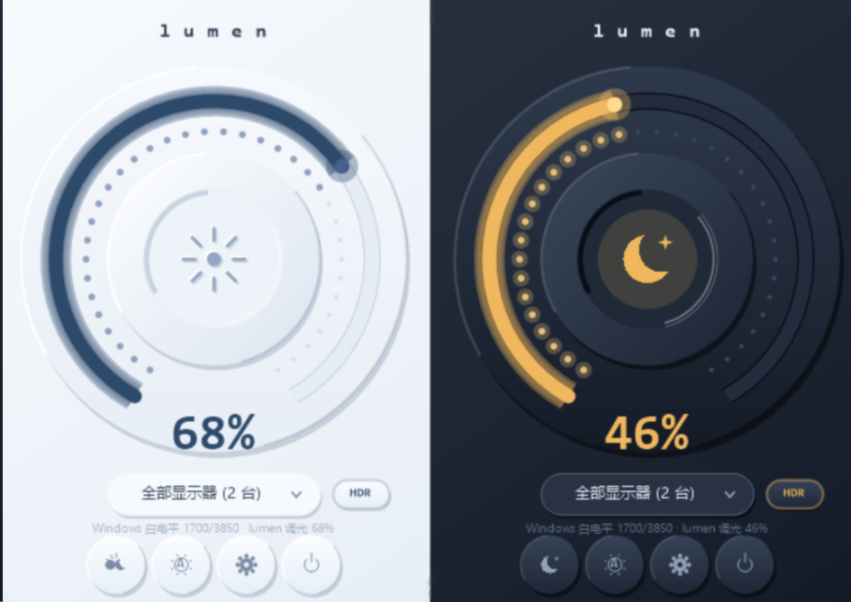
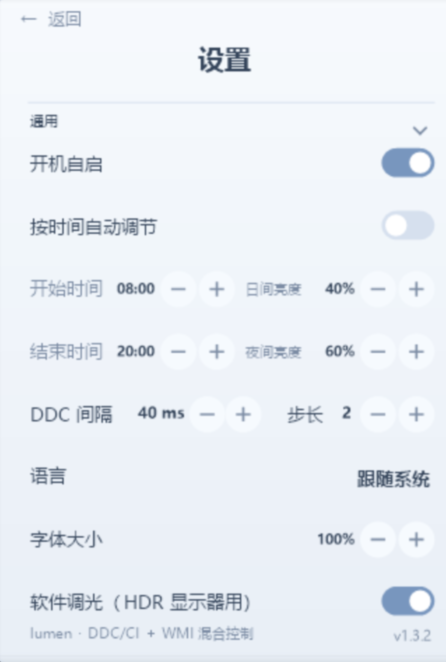

# lumen

原生 Windows 亮度控制。DDC/CI + WMI 混合通路，HDR 显示器可用软件调光兜底；Win32 + GDI+ 单文件实现（约 490 KB），免安装、无运行时依赖、界面全部矢量绘制。

**English**: Native Windows brightness control over a hybrid DDC/CI + WMI path, with a gamma-based software dimming fallback for HDR monitors. Single-file Win32 + GDI+ app (~490 KB) — portable, no runtime dependencies, fully vector-drawn UI.

<p align="center">
  
  
</p>

## 下载 · Download

到 [Releases](https://github.com/iosvcnm/lumen/releases/latest) 下载 `lumen.exe`，双击运行（Windows 10 / 11 x64，免安装）。启动后驻留托盘，左键托盘图标呼出面板，滚轮直接调节亮度。
Download `lumen.exe` from [Releases](https://github.com/iosvcnm/lumen/releases/latest) and run it (Windows 10 / 11 x64, no install needed). It lives in the tray — click the icon to open the panel and scroll to adjust brightness.

## 功能 · Features

- 混合亮度通路：外接屏走 DDC/CI，内置屏走 WMI，自动识别、统一调节
- 「全部显示器」同步 + 单屏偏移校准（多屏观感对齐）
- HDR 兼容：感知 Windows SDR 白电平，gamma 软件调光兜底（LUT 读回校验、自动降级）
- 按时间自动调节：日/夜目标亮度，切换时 5 秒平滑过渡
- 熄屏：DDC `0xD6` 电源命令，固件不支持时自动降级 `SC_MONITORPOWER` —— **MStar 方案显示器请先看下方警告**
- 调节方式：面板旋钮、托盘/面板滚轮、全局快捷键、键盘亮度键（HID）
- 设置页：折叠分组 + 页内滚动、中英双语、字体大小 90–110%、软件调光 / 标定 / 校准 / 诊断集中管理
- 记忆：显示器选择、面板与 OSD 位置、每台屏亮度、分组折叠
- 一键诊断复制；静默检查更新

## ⚠️ KTC / MStar 显示器熄屏警告

lumen 的「熄屏」按钮通过 DDC/CI `VCP 0xD6` 电源命令关闭显示器。**MStar 方案的显示器（KTC 全系，同方案机型如小米曲面 34" 等）存在已知固件缺陷：`0xD6` 电源命令可能把 OSD 永久写坏**——症状为按菜单键黑屏约 2 秒后画面恢复、但 OSD 菜单不再显示；断电重启、恢复出厂、`D6 05`、`VCP 04` 均无法清除该标志位（参见 supermar1010 的逆向分析与复现记录；KTC H27T22 进工程模式可见 MST9804 主控）。

**English**: The screen-off button turns the monitor off via the DDC/CI `VCP 0xD6` power command. Monitors with MStar scalers (all KTC models, the Xiaomi curved 34" and similar) have a known firmware defect: `0xD6` can permanently corrupt the OSD — pressing Menu blanks the picture for ~2 s, the image comes back, but the OSD menu never shows again. A power cycle, factory reset, `D6 05` or `VCP 04` do **not** clear that flag (see supermar1010's reverse-engineering notes; KTC H27T22 engineering mode reveals an MST9804 scaler).

不确定显示器方案时，请谨慎使用熄屏按钮；临时关屏可用系统自带的显示器休眠代替。
If you are unsure about your monitor's scaler, use the screen-off button with caution — prefer the system's own display sleep instead.

## 快捷键

| 组合 | 作用 |
| --- | --- |
| `Ctrl+PageUp` / `Ctrl+PageDown` | 亮度 ±5（默认，可在设置页录制修改） |
| `Ctrl+Alt+B` | 呼出 / 收起面板（默认，可改） |

组合必须包含 `Ctrl` 或 `Alt`；在设置页点「修改」直接录制，组合被占用时保留原键并提示。

## 构建

```bat
build.bat
```

需要 MSYS2 MinGW-w64 工具链（`g++` + `windres` 加入 `PATH`）；可选代码签名：设置 `SIGN_PFX` / `SIGN_PFX_PASS` 环境变量后自动签名。

## 配置

注册表 `HKCU\Software\lumen`，常用项：

| 键 | 含义 |
| --- | --- |
| `SelMonitor` | 记住的显示器选择（`ALL` 或 PnPId） |
| `Step` | 调节步长：1 / 2 / 5 / 10 |
| `AutoBrightness` / `AutoStartH` / `AutoEndH` | 按时间自动调节与起止小时 |
| `DayPct` / `NightPct` | 日 / 夜目标亮度 |
| `DdcDelay` | DDC/CI 两次指令的最小间隔（ms） |
| `ThemeMode` | 0 跟随系统 / 1 浅色 / 2 深色 |
| `Lang` | 0 跟随系统 / 1 中文 / 2 English |
| `FontPct` | 界面字体大小：90–110%（默认 100） |
| `GammaDim` | 软件调光（HDR 显示器用） |
| `KeyBright` | 键盘 HID 亮度键开关 |
| `WheelTray` / `WheelPanel` | 托盘图标 / 面板打开时的滚轮调节开关 |

其余记忆项（亮度 `Last_<屏>`、面板与 OSD 位置 `PanelX/Y` `OsdX/Y`、分组折叠 `SetFold`、单屏偏移 `Off_<屏>`、HDR 标定 `WlMax`、托盘图标坐标 `TrayX/Y` 等）由程序自动维护。

## 已知边界

- 显示器 OSD 菜单里必须开启 DDC/CI，否则该屏不可控。
- 内置屏 WMI 写入约 0.5–1 s，「全部显示器」同步会随之变慢，UI 不受影响。
- HDR 开/关后数秒内 DDC/CI 短暂失联（固件行为）：程序带看门狗与冷却自愈，期间建议用「软件调光」。
- 熄屏的 DDC 通路见上方 **KTC / MStar 警告**；固件不支持时自动降级 `SC_MONITORPOWER`（会把所有屏一起关掉）。
- 程序以 `asInvoker` 运行；前台是管理员窗口时，全局热键受 UIPI 限制。
