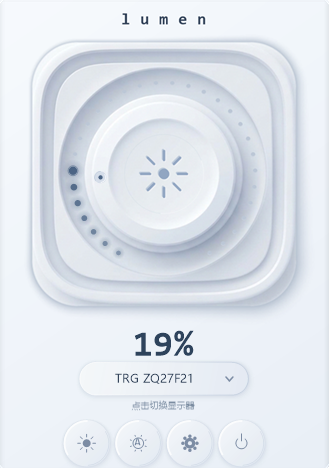
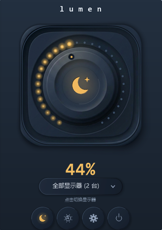

# lumen v1.5.0 更新说明

v1.5.0 在 v1.4.3 基础上完成界面重制，并新增快捷键取消绑定与 OLED 像素刷新提醒两个功能。

<p align="center">
  
  
</p>

## 新增

- 全新**新拟物双主题**：浅色陶瓷白 / 深色曜石金，主旋钮、底部按钮、托盘图标同步重绘，跟随系统深浅色
- **全局快捷键可取消绑定**（#9）：录制时按 `Esc` 即可解除绑定并释放系统热键；键帽显示「未绑定」，点击可随时重新绑定
- **OLED 像素刷新提醒**：设置 → 亮度与显示中可设间隔（默认 4 小时，1–12 小时可调或关闭）；后台静默统计连续亮屏时长，睡眠、熄屏或屏保自动清零重计，满间隔弹一次轻量托盘提醒，建议暂离熄屏让面板自动执行像素补偿
- 设置页重排为 **5 个折叠分组**：通用 / 全局快捷键 / 鼠标与键盘 / 亮度与显示 / 关于
- 主面板静态层缓存 + 2× 超采样抗锯齿，拖动更流畅

## 修复 / 改进

- 屏保 / 休眠唤醒后亮度恢复更可靠（强制重放记忆亮度，清除 DDC 冷却期与 gamma 静默期）
- 设置页分组标题字号过小：12px → 16px
- 「关于」分组简化为 GitHub 卡片；诊断保留 `lumen.exe --diag`
- 中英双语完整覆盖新增功能

## 性能实测

同一台机器（16 核）、同一面板位置、真实鼠标连续拖动 2.5 秒，两版交替各跑 3 轮：

| 指标（三轮中位数） | v1.4.3 | v1.5.0 |
| --- | --- | --- |
| 拖动 2.5s CPU 时间 | 406 ms | **78 ms**（−81%） |
| 拖动期间单核占用 | ~16% | ~3% |
| 托盘常态内存 | 18.9 MB | 18.9 MB |
| 面板打开内存 | 29.3 MB | 31.4 MB（静态层缓存） |
| GDI / USER 对象 | 16 / 27 | 16 / 27 |
| 启动到可响应 | ~78 ms | ~78 ms |

拖动时只重绘动态层，是差距的主因；常驻内存与启动耗时基本不变。

## 升级说明

- 不用全局快捷键：设置 → 全局快捷键 → 点「修改」进入录制后按 `Esc` 解除绑定
- OLED 提醒默认开启、间隔 4 小时；不需要时将该行间隔调至 `off` 即可
- 主题、语言、字体缩放等原有设置全部保留，升级无需重新配置

## ⚠️ 提醒

- KTC/MStar 方案显示器存在「DDC 熄屏可能永久损坏 OSD」的已知固件缺陷；启用「精确熄屏」前请先阅读 README 警告。

## SHA-256

```
be16f3b515ce47d5d05fdd1ee8e89505a4b2f1bda43166829cf89c87812bc032  lumen.exe
```
